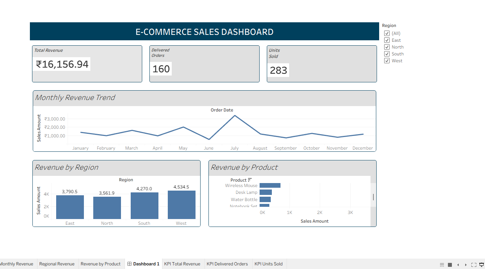

# E-Commerce Sales Analysis 📊

## 📌 Project Overview

This project analyzes e-commerce sales data using SQL, Microsoft Excel, and Tableau. The goal is to identify revenue trends, compare regional performance, and discover the products and categories contributing the most revenue.

This project demonstrates practical data analytics skills, including data aggregation, business analysis, interactive dashboards, and data visualization.

## 🛠️ Tools & Technologies

- **SQL** — Data analysis, filtering, aggregation, and grouping
- **Microsoft Excel** — PivotTables, charts, KPI cards, and interactive slicers
- **Tableau Public** — Dashboard creation and data visualization
- **CSV** — Dataset storage and exchange

## 📊 Dashboard Preview

*Interactive dashboard created in Tableau. The image above is a static preview.*

## 📈 Key Performance Indicators

| Metric | Result |
|---|---:|
| Total Revenue from Delivered Orders | ₹16,156.94 |
| Delivered Orders | 160 |
| Units Sold (Tableau KPI) | 283 |
| Total Records | 180 |

## 🔍 Analysis Performed

- Analyzed monthly revenue trends across 2025.
- Compared revenue across West, South, East, and North regions.
- Identified the top five products by revenue.
- Compared sales performance across product categories.
- Examined delivered, returned, and cancelled order counts.
- Built interactive visualizations with a Region filter.

## 💡 Key Findings

- **Best month:** July recorded the highest monthly revenue.
- **Top product by revenue:** 27-inch Monitor, generating ₹3,482.10.
- **Top region by revenue:** West, generating ₹4,534.51.
- **Top category by revenue:** Electronics, generating ₹8,424.60.
- **Highest order volume by region:** South, with 50 delivered orders.
- **Highest unit volume by category:** Accessories, with 114 units sold.

These findings illustrate how revenue and sales volume can differ across products, categories, and regions.

## 📁 Project Files

- `ecommerce_sales_analysis.sql` — SQL queries used for analysis
- `ecommerce_sales_analysis_dataset.csv` — Practice dataset
- `Ecommerce_Sales_Analysis.twbx` — Tableau packaged workbook
- `README.md` — Project documentation

*Make sure the filenames above match the actual filenames in this repository.*

## 🧠 SQL Skills Demonstrated

- SELECT, WHERE, ORDER BY, and GROUP BY
- Aggregate functions such as SUM and COUNT
- Filtering completed orders
- Revenue analysis by month, product, region, and category
- Sorting and limiting results
- Date functions and data aggregation

## 🚀 What I Learned

Through this project, I practiced converting raw sales records into meaningful business insights, validating SQL results against Excel, and presenting findings through a Tableau dashboard.

## 📝 Dataset Disclaimer

This project uses a **synthetic practice dataset** created for learning and portfolio development. The results are illustrative and do not represent actual sales from a real company.

## 👤 Author

**Kotireddy Vanteddu**

Aspiring Data Analyst | SQL | Excel | Tableau

